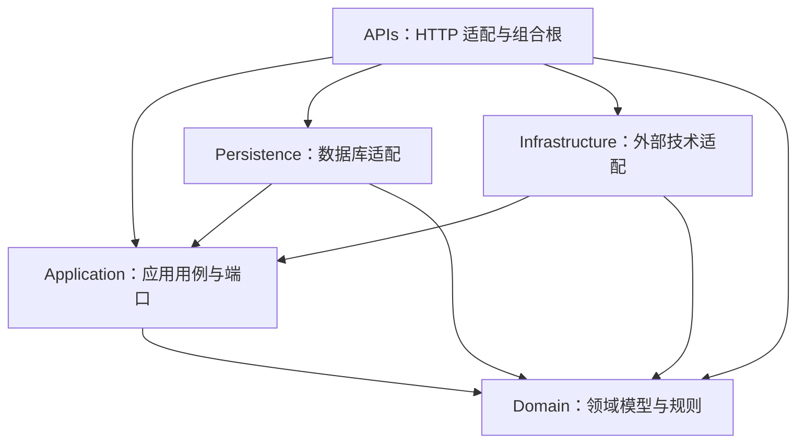
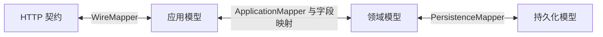
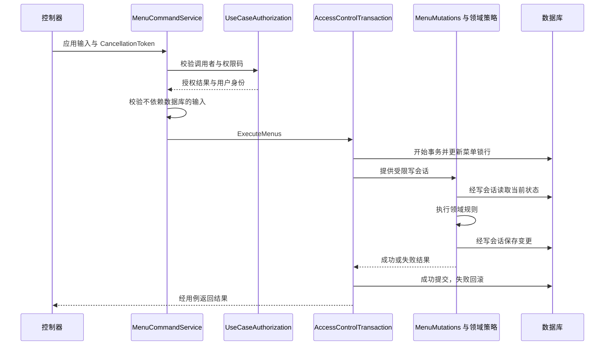

# 项目架构

本文依据当前项目代码总结架构及运行机制。项目是基于 .NET 10 的单体 ASP.NET Core 后端，采用按职责拆分的项目结构和向内依赖的设计，以菜单、角色授权和身份会话为主要业务范围。部署入口为 `My.XXX.APIs`，各业务模块运行在同一进程中。

## 1. 分层与依赖方向

图中的箭头表示项目引用方向。持久化层与基础设施层分别实现应用层定义的端口，不相互引用。API 项目可以引用各层完成依赖装配，但控制器、HTTP 映射和响应适配代码不能绕过应用用例直接访问存储。

| 层 | 主要职责 | 代表代码 |
| --- | --- | --- |
| APIs | 路由、HTTP 请求与响应、认证授权适配、异常处理、配置与依赖装配 | `Program`、各控制器、`WireMapper`、`TokenAuthentication` |
| Application | 编排业务流程、授权、事务边界、应用模型、存储与外部能力端口 | `MenuCommandService`、`MenuQueryService`、`UseCaseAuthorization`、`IAccessControlTransaction` |
| Domain | 业务状态、输入与状态转换规则、稳定权限码、领域错误 | `MenuState`、`MenuHierarchy`、`MenuTransitions`、`PermissionCodes`、`DomainResult` |
| Persistence | LINQ to DB 数据访问、数据库事务、持久化映射、迁移和结构检查 | `DBContext`、`AccessControlTransaction`、`AuthenticationStore`、`MigrationRunner` |
| Infrastructure | Redis、加密和指标装饰器等技术能力 | `CachedPermissionStore`、`PermissionCache`、`AesEncryptionKey`、`MeasuredSessionService` |

领域层没有第三方包和其他项目依赖；应用层仅引用领域项目，可使用 FluentResults、Mapperly 和依赖注入等库，但不依赖 ASP.NET Core、数据库驱动或 Redis。存储和事务端口定义在应用层，领域层保持业务规则的独立性。

## 2. 组合根与运行入口

`Program.CreateApplication` 是正常服务运行的组合根，依次装配配置、Web 服务、数据库、应用服务、仓储和技术适配器。各层通过自己的注册入口提供实现，宿主决定如何组合。

- 数据库上下文和仓储按请求作用域注册。
- `ISessionService` 使用 `MeasuredSessionService` 装饰，增加会话指标。
- 启用权限缓存时，`IPermissionStore` 使用 `CachedPermissionStore` 装饰；应用用例仍执行自身规则。
- Redis 连接复用 `IConnectionMultiplexer`；未启用缓存时，权限查询直接走数据库。

主要 HTTP 管道顺序为转发头处理、环境相关诊断与 HSTS、开发环境 Swagger、异常处理中间件、静态文件、路由、限流、跨域、认证、授权，最后映射控制器与健康检查。

程序另有 `--migrate` 分支，执行数据库迁移后退出；该分支不会启动 HTTP 服务，正常启动也不会隐式执行迁移。

## 3. 模型与映射边界

不同边界使用独立模型，避免数据库列或 HTTP 契约成为领域规则的一部分。

- **HTTP 契约**位于 API 的 `Contracts` 下，表达请求、分页和响应结构。
- **应用模型**表达用例输入、查询条件和展示结果，例如 `MenuCreation`、`MenuModification`、`MenuView`、`MenuSearch`。
- **领域模型**表达菜单状态和业务语义。导航信息使用 `MenuDestination`，以 `Address`、`View`、`Resource`、`Operation` 等字段表示目的地。
- **持久化模型**描述数据表及列映射；菜单存储仍使用 `Url`、`Component`、`ControllerName` 等字段，通过映射与领域模型隔离。

认证用户使用独立的 `IdentitySnapshot` JSON 存储结构，当前写入版本为 1，并兼容旧版 0。该结构不依赖公开用户响应模型，未知版本会被拒绝。

## 4. 菜单查询与命令

菜单读写入口分别为 `MenuQueryService` 和 `MenuCommandService`。这是同一服务、同一数据库中的读写职责分离。

### 查询流程

控制器将 HTTP 查询转换为应用输入，应用查询服务先执行授权，再通过 `IMenuReadRepository` 获取数据。分页规则由 `PageWindow` 规范化，树结构由应用层的 `MenuTree.Build` 构建，最后映射为 HTTP 响应。

角色菜单树通过菜单集合与角色已选菜单集合计算勾选状态。显示菜单树使用显示条件筛选；角色菜单选择和接口权限查询是两套独立流程。

### 写入流程

`MenuMutations` 是内部辅助类，负责协调存储原语与领域策略，不作为公开用例入口。`MenuHierarchy`、`MenuRemoval`、`MenuOrder` 和 `MenuTransitions` 负责父子关系、删除约束、排序及状态变更判断。

依赖当前数据库状态的判断在加锁事务内执行，防止校验后、写入前状态被其他请求改变。新增与更新记录操作者和 UTC 时间，删除菜单时同时软删除相关角色菜单关联。

## 5. 事务与并发约束

应用层的 `IAccessControlTransaction` 提供菜单、角色菜单、权限和组合写入入口。回调获得的写会话只暴露对应操作需要的持久化原语，业务规则仍由应用层与领域层处理。

持久化实现使用 `AtomicWrite` 管理数据库事务：返回成功结果才提交，业务失败结果或异常都回滚；请求取消后仍使用不受取消影响的令牌执行回滚清理。

| 写入类型 | 并发控制 |
| --- | --- |
| 菜单修改、排序、删除 | 更新固定的 `MenuWriteLock` 行，在事务期间串行协调菜单写入 |
| 角色菜单分配 | 共享菜单锁，防止与菜单删除并发后留下无效关联 |
| 角色权限替换 | 更新固定的 `PermissionRevision` 行，推进权限版本并协调权限写入 |
| 菜单与权限组合操作 | 先获取菜单锁，再更新权限修订行，保持固定顺序 |

`RoleAccessAdministration.ReplaceAsync` 可以在一个事务内替换角色菜单与权限码，并分别要求对应的两项权限；当前控制器未暴露这个组合用例。

写会话在事务结束后失效，禁止继续使用；同一事务适配器不支持嵌套写事务，组合操作应复用已有会话。固定锁行简化了跨请求和跨实例的协调，但也使相应写入共享串行入口；这是当前实现的并发粒度。

## 6. 身份认证与会话

认证分为访问 JWT 和刷新 JWT 两种用途。默认 Bearer 方案验证访问令牌，`Refresh` 方案验证刷新令牌；两者校验签名、签发者、受众、过期时间和 `token_use`，刷新受众附加 `:refresh`。

JWT 验证通过后仍调用 `ISessionService.ValidateAsync` 查询数据库，检查会话是否存在、撤销或过期，以及用户是否启用。应用层再次核对会话所属用户、有效期和刷新令牌 ID。令牌不是独立于数据库会话的认证依据。

认证适配器根据数据库中的当前用户信息重建角色和相关声明，因此用户角色变更或管理员身份移除不会继续沿用令牌内的旧角色。

- `SessionService.IssueAsync` 为已有且启用的用户建立会话并签发令牌。
- `AuthenticationService.RefreshAsync` 使用条件更新将旧刷新令牌 ID 替换为新 ID；并发刷新或重复使用旧令牌时，只有满足当前 ID 的请求能够成功。
- 刷新令牌轮换沿用会话的固定截止时间，不重新延长会话寿命。
- 注销通过 `AuthenticationStore.RevokeAsync` 标记会话撤销，后续认证检查会拒绝该会话。

当前 HTTP 接口提供刷新、撤销会话和当前用户信息，没有登录或注册入口。业务接入需补充初次身份验证及用户同步流程。

## 7. 权限与缓存一致性

`PermissionCodes` 定义稳定且受保护的权限码目录。角色权限存储在 `RolePermission` 中，角色菜单选择存储在 `RoleMenu` 中；菜单选择不会自动等同于接口操作权限。

HTTP 的权限特性及处理器与应用用例共享 `UseCaseAuthorization`。该服务先要求已认证用户和合法权限码，再判断 `AppAdmin`、权限白名单或角色权限。白名单不会放行匿名请求，管理员身份也不会放行未定义的权限码。`RequireAnyAsync` 接受多个权限码时采用满足任一项的语义；组合用例需要分别检查必需权限。

权限缓存装饰在 `IPermissionStore` 下方，缓存角色集合对应的权限投影：

1. 从数据库读取 `PermissionRevision`。
2. 根据前缀、角色集合与修订号构造缓存键。
3. 命中则读取 Redis，未命中则读取数据库权限。
4. 再次读取修订号；版本相同才接受结果，并在未命中时写入带 TTL 的缓存。
5. 如果版本改变，最多尝试三轮；持续变化时直接读取数据库。

权限修改与修订号推进处于同一事务。新修订号使后续请求使用新缓存键，旧键通过 TTL 回收。默认缓存有效期为 5 分钟。

这里的数据库回退针对修订号持续变化。`CachedPermissionStore` 没有捕获 Redis 读写异常并自动降级的逻辑；启用缓存时 Redis 同时纳入就绪检查。

## 8. 错误与 HTTP 边界

领域层使用 `BusinessError` 和 `DomainResult` 表达业务失败；应用层转换为 FluentResults，通过明确结果返回校验、授权及业务错误。

API 的 `ResultResponseExtensions` 将应用结果映射为 HTTP 状态和 `APIResponse<T>`。通用响应包含业务状态、消息、数据、错误码和追踪标识；未预期异常由 `ExceptionHandlingMiddleware` 处理。数据库事务不会把意外异常伪装成业务成功。

控制器通过 `HttpContext.RequestAborted` 向下传递取消令牌。`HttpCurrentRequest` 将 HTTP 身份上下文适配为应用端口，应用用例不直接依赖 `HttpContext`。

## 9. 数据库、迁移与运行保障

`DatabaseConfiguration` 统一选择 SQL Server 或 PostgreSQL，并配置 LINQ to DB 与对应连接类型。两种数据库使用独立迁移脚本，覆盖菜单、认证会话、权限修订、稳定权限目录、菜单锁和审计时间字段等结构。

`MigrationRunner` 通过数据库会话锁协调迁移，在 `SchemaMigrations` 中记录脚本名及 SHA-256 校验和。已应用脚本内容改变会导致校验失败；兼容检查允许存在较新的附加迁移，支持增量部署。

- `/healthy` 只确认服务存活，不检查依赖。
- `/ready` 检查数据库、必要迁移及业务表结构；启用权限缓存时还检查 Redis。
- AES-GCM 用于带 `enc:v1:` 前缀的配置密文，以及数据保护密钥的持久化加密。
- Serilog 提供日志，OpenTelemetry 采集 HTTP、数据库、运行时及自定义会话和授权指标；OTLP 导出可配置，健康检查路径排除在 HTTP 追踪之外。
- 容器以非 root 用户运行；生产模式按入口代理终止 TLS 的方式配置转发头与 HSTS。

## 10. 架构验证与扩展方式

单元测试直接覆盖领域策略、用例授权、事务入口约束和项目依赖。架构测试检查领域层无第三方依赖、项目引用向内、内部 `Mutations` 类不公开，以及领域模型不泄漏 Web 字段名称。

集成测试覆盖 HTTP 契约、数据库迁移和事务、权限缓存、会话指标、配置及遥测。`ArchitectureBoundaryTests` 检查控制器与 HTTP 适配器的类型依赖及 IL，包括异步状态机，防止通过静态调用或服务定位绕过用例访问存储。数据库测试通过本机 PostgreSQL 工具建立隔离集群。

新增业务时，建议沿用现有边界：领域层定义状态和规则，应用层定义用例及必要端口，持久化或基础设施层实现端口，API 层定义 HTTP 契约并完成装配。写入应经过公开用例的授权与事务入口；新增表结构使用新迁移；架构边界与关键业务约束加入现有测试体系。

本文描述的是当前代码结构与机制，运行配置和启动命令见 [README](../README.md)。
